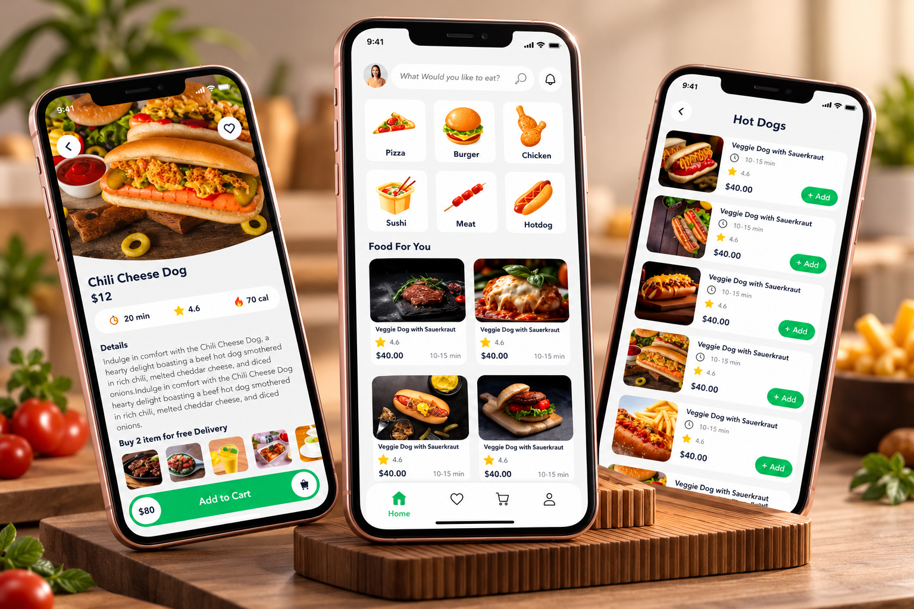

<div align="center">

# 🍔 Foody — Food Ordering App

### Kotlin • Native Android • Food Ordering UI

A food-themed Android application developed using **Kotlin**, designed to showcase a modern mobile experience for exploring meals and food ordering concepts.

The project demonstrates native Android development, user interface design, and application organization using Kotlin and Gradle.


</div>

---

## 📸 Project Preview

<div align="center">

<a href="69494dc1-6e90-4ae1-881d-9eaaf528e6ee.png">
  
</a>

</div>

---

## 📖 About the Project

**Foody** is a native Android application built using Kotlin.

The project focuses on creating a food-related mobile interface and exploring how users can browse meals through an organized and visually appealing application.

It showcases practical Android development concepts, including Kotlin programming, mobile layouts, application resources, and Gradle project configuration.

---

## ✨ App Highlights

### 🍽️ Food Browsing Experience

- Food-focused mobile application interface.
- Meal and food presentation.
- Organized food content.
- Visually appealing layouts.
- User-friendly browsing experience.

### 📱 Native Android Development

- Developed using Kotlin.
- Native Android project structure.
- Android UI components.
- Android Studio development workflow.
- Gradle build configuration.

### 🎨 UI/UX Design

- Modern food-themed interface.
- Attractive food imagery.
- Organized content layouts.
- Readable typography.
- Mobile-friendly design.
- Consistent visual presentation.

---

## 🛠️ Technologies Used

| Technology | Purpose |
|------------|---------|
| Kotlin | Main programming language |
| Android SDK | Native Android development |
| Android Studio | Development environment |
| Gradle | Dependency and build management |
| Git | Version control |
| GitHub | Source code hosting |

---

## 🏗️ Application Overview

```text
               Foody App
                   |
                   v
            Native Android UI
                   |
                   v
             Kotlin Logic
                   |
                   v
              Food Content
                   |
                   v
             Meal Browsing
```

This diagram represents the application's general concept rather than a verified internal architecture.

---

## 📂 Repository Structure

Based on the GitHub repository listing:

```text
appFinalFoody/
│
├── .idea/
├── app/
├── gradle/
│
├── .gitignore
├── 69494dc1-6e90-4ae1-881d-9eaaf528e6ee.png
├── build.gradle
├── gradle.properties
├── gradlew
├── gradlew.bat
├── settings.gradle
└── README.md
```

### Main Components

**`app/`**

Contains the Android application module, including source code and resources.

**`gradle/`**

Contains Gradle wrapper configuration.

**`build.gradle`**

Defines build configuration and dependencies.

**`settings.gradle`**

Configures the project's Gradle modules.

---

## 🚀 Getting Started

### Prerequisites

Before running the application, install:

- Android Studio
- Android SDK
- Compatible JDK
- Git
- Android emulator or physical device

### 1. Clone the Repository

```bash
git clone https://github.com/AhmedJaberAhmed/appFinalFoody.git
```

### 2. Open the Project

Open Android Studio and select:

**File → Open → appFinalFoody**

### 3. Sync Gradle

Allow Android Studio to download and configure the required dependencies.

If necessary, select:

**File → Sync Project with Gradle Files**

### 4. Run the Application

1. Start an Android emulator or connect a physical device.
2. Select the app run configuration.
3. Click **Run ▶**.

### 5. Build from Terminal

On Windows:

```bash
gradlew.bat assembleDebug
```

On macOS/Linux:

```bash
./gradlew assembleDebug
```

The project requires an Android SDK and JDK compatible with its Gradle configuration.

---

## 💡 Development Highlights

This project demonstrates experience in:

- Kotlin programming.
- Native Android application development.
- Android UI implementation.
- Gradle project configuration.
- Mobile application structure.
- Android resource management.
- Food-themed mobile interface design.

---

## 🎯 Project Goals

- Develop a native Android application using Kotlin.
- Create a food-focused mobile experience.
- Practice Android interface development.
- Improve Kotlin programming skills.
- Build a structured Android Studio project.

---

## 🔮 Potential Future Improvements

- 🛒 Shopping cart functionality.
- 🔍 Food search and filtering.
- ❤️ Favorite meals.
- 📋 Food categories.
- 💳 Online payment integration.
- 📦 Order tracking.
- 🔐 User authentication.
- ☁️ Backend integration.
- 🔔 Order notifications.
- ⭐ Food ratings and reviews.

---

## 👨‍💻 Developer

**Ahmed Jaber Ahmed**

Mobile App Developer | Flutter & Kotlin

B.Sc. Computer Science & Artificial Intelligence

📍 Cairo, Egypt

- [GitHub](https://github.com/AhmedJaberAhmed)
- [Portfolio](https://ahmedjaberahmed.github.io/Jaber-website/)
- [LinkedIn](https://www.linkedin.com/in/ahmedjaberahmed/)

---

<div align="center">

### ⭐ Support the Project

If you find this project interesting, consider giving it a star!

**Built with Kotlin 💜 and Android 🤖**

</div>
